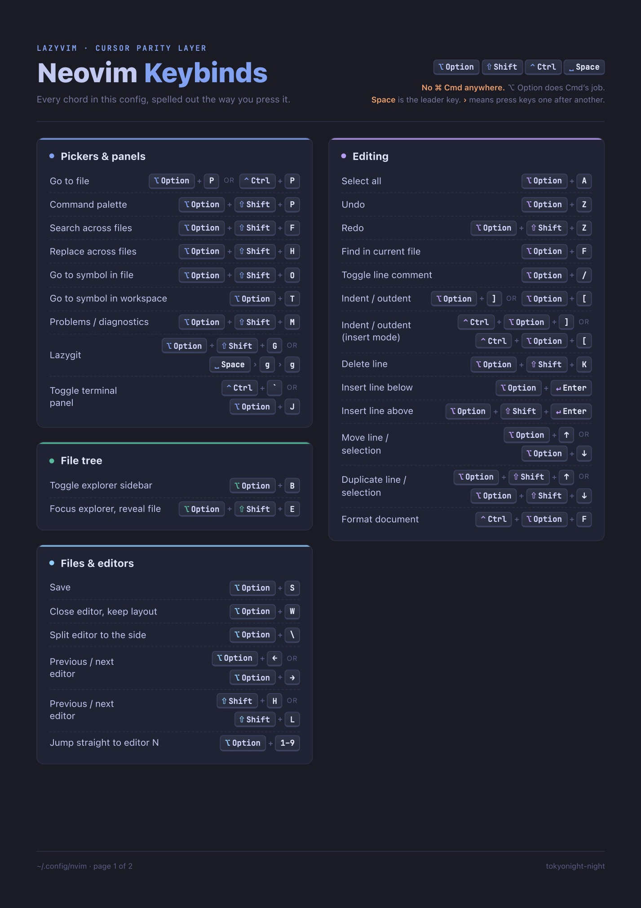
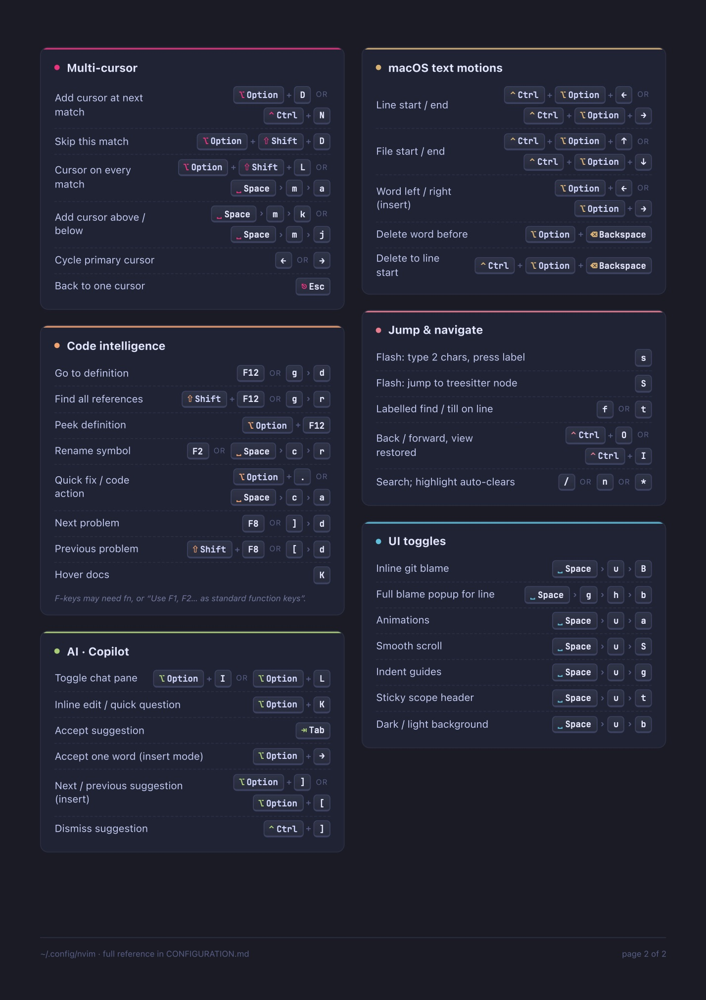

<div align="center">

# ⌥ nvim

**A Cursor-style Neovim for the macOS terminal.**
LazyVim with Cursor/VS Code muscle memory, Copilot inline AI, multi-cursor,
and a smooth, animated UI. No ⌘ Cmd anywhere: ⌥ Option does Cmd's job.

[](https://neovim.io)
[](https://lazyvim.org)
[](https://github.com/folke/tokyonight.nvim)
[](LICENSE)

[**Cheat sheet (PDF)**](keybinds.pdf) · [**Full reference**](CONFIGURATION.md) · [**Install**](#install)

<br>

<a href="keybinds.pdf"></a>
<a href="keybinds.pdf"></a>

</div>

---

## Why

Cursor and VS Code are comfortable. Terminal Neovim is fast. This config gives
you both: the panels, chords and AI flow you already know, inside LazyVim.

- **Familiar chords.** `⌥P` opens a file, `⌥⇧P` opens the command palette,
  `⌥D` adds a cursor, `⌥/` comments, `F12` jumps to a definition.
- **No ⌘ Cmd.** Terminal apps grab Cmd chords before Neovim sees them, so every
  binding uses Option instead. Option+Shift and Ctrl+Option are used only when
  two actions need the same letter. [Why →](CONFIGURATION.md#no-cmd-anywhere--why)
- **Cursor-style AI.** Copilot suggestions appear as ghost text and `Tab`
  accepts them. Chat sits in a right-hand sidebar (`⌥I`) and `⌥K` does inline edits.
- **Feels premium.** Springy cursor smear with a light particle trail, eased
  scrolling, animated window open/close/resize, a scope line that fades in,
  and rounded borders on every popup.
- **Fast.** Lazy-loaded: starts in about 40ms with only a handful of plugins
  loaded, and no duplicate renderers or needless background work.

## Highlights

| | |
| --- | --- |
| 🗂 **Explorer** | neo-tree that behaves like Cursor's: single-click open, follows the current file, shows dotfiles |
| 🧭 **Pickers** | Files, text, symbols and commands via snacks.picker, ranked by how often you use them |
| ✨ **Multi-cursor** | `⌥D` next match, `⌥⇧D` skip, `⌥⇧L` every match (multicursor.nvim) |
| ⚡ **Jump anywhere** | flash.nvim labels for `s`, `S`, `f`, `t` |
| 🤖 **AI** | copilot.lua ghost text plus CopilotChat sidebar |
| 🌿 **Git** | Inline blame at the end of the line, lazygit on `⌥⇧G`, gitsigns in the gutter |
| 🧪 **Languages** | LSP, formatting, linting, testing and debugging for TS, Python, Go, Rust, Docker, YAML, TOML, Markdown, Tailwind |
| 🎨 **Look** | tokyonight-night, transparent for blurred or translucent terminals |

## Install

**Requirements:** Neovim ≥ 0.11, `git`, a [Nerd Font](https://www.nerdfonts.com),
`ripgrep`, and a terminal that sends Option as Meta. Optional: `lazygit`, a
GitHub Copilot subscription.

```bash
# back up any existing config
mv ~/.config/nvim{,.bak}
mv ~/.local/share/nvim{,.bak}

git clone https://github.com/virajshoor/nvim ~/.config/nvim
nvim   # plugins install on first launch
```

Then run `:Copilot auth` once to sign in to Copilot.

> **Option as Meta:** in Ghostty use `macos-option-as-alt = true`, in iTerm2
> set Profiles → Keys → Left Option to `Esc+`, and in kitty use
> `macos_option_as_alt yes`. Without this, `⌥` chords type special characters
> instead of reaching Neovim.

## Essential keys

`Space` is the leader key. The [PDF](keybinds.pdf) lists every chord.

| Keys | Action | | Keys | Action |
| --- | --- | --- | --- | --- |
| `⌥P` | Go to file | | `⌥D` | Add cursor at next match |
| `⌥⇧P` | Command palette | | `⌥/` | Toggle comment |
| `⌥⇧F` | Search across files | | `⌥↑` `⌥↓` | Move line |
| `⌥B` | Toggle explorer | | `⌃⌥F` | Format document |
| `⌥S` / `⌥W` | Save / close editor | | `F12` / `F2` | Definition / rename |
| `⌥1`–`⌥9` | Jump to editor N | | `⌥.` | Quick fix |
| `⌥J` | Terminal | | `⌥I` / `⌥K` | AI chat / inline edit |
| `⌥⇧G` | Lazygit | | `Space u B` | Toggle inline blame |

## Layout

```
init.lua                  → require("config.lazy")
lua/config/lazy.lua       lazy.nvim bootstrap, update checker, disabled built-ins
lua/config/options.lua    editor feel: clipboard, tabs, cursor blink, diffs, title
lua/config/keymaps.lua    the Option-based Cursor/VS Code layer
lua/config/autocmds.lua   cursorline follows focus, yank flash, auto-clearing search
lua/plugins/ui.lua        bufferline, lualine, snacks, animations, floats, blame
lua/plugins/editor.lua    multicursor, mini.move, neo-tree, flash
lua/plugins/ai.lua        Copilot ghost text and chat sidebar
lua/plugins/colorscheme.lua  tokyonight-night, transparent
lazyvim.json              enabled LazyVim extras
```

[CONFIGURATION.md](CONFIGURATION.md) explains each design decision and covers
how to add a keybind without breaking another one.

## Credits

Built on [LazyVim](https://github.com/LazyVim/LazyVim) by
[@folke](https://github.com/folke), with
[smear-cursor.nvim](https://github.com/sphamba/smear-cursor.nvim),
[mini.nvim](https://github.com/nvim-mini/mini.nvim),
[multicursor.nvim](https://github.com/jake-stewart/multicursor.nvim),
[copilot.lua](https://github.com/zbirenbaum/copilot.lua) and
[CopilotChat.nvim](https://github.com/CopilotC-Nvim/CopilotChat.nvim).

Licensed under [Apache 2.0](LICENSE).
